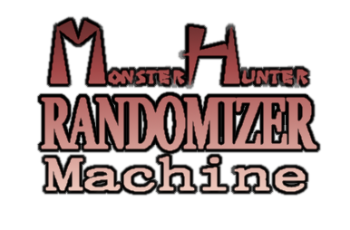

# Monster Hunter Randomizer Machine (ANDROID)

A simple Monster Hunter challange randomizer made in Godot, this is the android version

You can choose monsters, weapons and conditions for the randomization poll, it coutains several presets for different games as well as a custom mode with everything

You can also save your conditions as .JSON files and share with other people

There's also a Web version that's based on this repo, and a native PC version which you can find here:

Web (Itch.io): https://dr-nimbos.itch.io/mh-randomizer-machine

PC: https://github.com/DrNimbos/MHRandomizerMachine-PC

